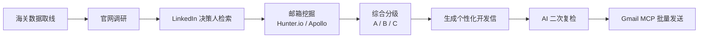

# OpenClaw 海外获客自动化工作流

> 基于本地部署的开源 Agent 框架 **OpenClaw**，把「海关数据 → 客户背调 → 决策人 / 邮箱挖掘 → 意向分级 → 个性化开发信 → AI 复检 → 邮件批量发送」串成一条自动化流水线，用于外贸客户的初步筛选与触达。

## 背景

传统海外获客的第一步——客户背调——高度重复：逐家查官网、翻 LinkedIn 找采购负责人、想方设法挖邮箱、再手写开发信。这个过程耗时且容易漏掉重点客户。

本项目把这条链路交给一个本地部署的 Agent，用**结构化提示词**驱动多步工具调用，把「几十家候选公司」的初筛从数天压缩到一次运行。

## 工作流



**分级规则**

| 等级 | 判定 | 处理 |
| --- | --- | --- |
| A（强烈推荐） | 产品高度匹配 + 找到具体决策人姓名和邮箱 | 定向发送开发信 |
| B（值得跟进） | 产品匹配，但只有通用邮箱，或只有人没邮箱 | 人工补充后跟进 |
| C（暂时搁置） | 产品不相关，或找不到任何联系人 | 归档 |

## 目录结构

本工作流在「外贸 AI 工作流集」中的位置：`01-leadgen-openclaw/`

```
01-leadgen-openclaw/
├── README.md                     # 本文件
├── prompts/
│   ├── 01_customer_research.md   # 客户背调（官网调研 + LinkedIn + 邮箱挖掘 + 分级）
│   └── 02_outreach_email.md      # 个性化开发信生成
└── docs/
    └── architecture.md           # 架构与数据流说明
```

## 快速开始

1. **本地部署 OpenClaw**（开源 Agent 框架）。
2. **准备候选名单**：从海关数据平台等公开渠道导出一批目标公司（每行一个）。
3. **配置工具链**：LinkedIn 检索、Hunter.io / Apollo（邮箱挖掘）、Gmail（发送）——均需自备账号与 API Key。
4. **运行背调提示词**：把 `prompts/01_customer_research.md` 的模板连同名单交给 Agent，得到分级结果。
5. **生成并复检开发信**：用 `prompts/02_outreach_email.md` 为 A 类客户生成邮件草稿，AI 复检无误后经 Gmail MCP 批量发送。

## 关于密钥

本仓库**不包含任何账号、密码或 API Key**。请把你的凭据放在本地环境变量或未纳入版本控制的配置文件中（见 `.gitignore`）。

## 合规与免责

- 仅用于合规的商务拓展，请遵守目标平台的用户协议与所在地数据保护法规（如 GDPR）。
- 抓取与邮件触达请控制在合理频率，避免骚扰。

## License

MIT
