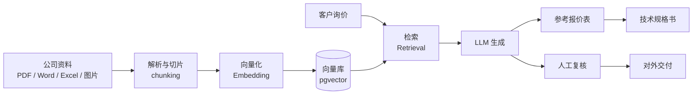

# 04 · 企业知识库 + 自动报价 / 技术规格书（规划）

> 把公司的产品与商务资料做成知识库，让 AI 基于**自有资料**回答，并自动产出**参考报价表**与**技术规格书**。

## 要解决的问题

外贸报价的痛点是"**资料散、查得慢、写规格书靠人肉翻标准**"。同一个型号的选型、材质、压力等级、附件配置，散落在产品图册、选型表、历史报价和各种标准里，每次报价都要重新翻一遍。

## 目标

1. 把公司资料统一入库：**采购文件、投标标书、资质证书、产品图册、选型表、报价表、技术规格书**；
2. 客户询价进来后，RAG 检索相关资料，自动生成一份**可供参考的报价表**；
3. 基于报价表，进一步生成对应的**技术规格书**（含标准引用、材质、压力等级、附件配置）。

## 架构设想

## 技术选型（草稿）

| 环节 | 方案 |
| --- | --- |
| 资料解析 | PDF / Office 文本抽取，扫描件走 OCR |
| 切片 | 按语义 / 标题层级切片（chunking） |
| 向量化 | Embedding 模型（本地或 API） |
| 向量库 | **pgvector**（复用 Postgres，部署最简） |
| 编排 | 本地 LLM 或 API 模型 + 检索增强生成 |
| 输出 | 结构化表格（报价表）+ 文档（技术规格书） |

## 现状

🔵 **规划中，尚未实现。** 本目录先放设计草案，作为下一步施工的蓝图。

## 重要前提

- 报价表与技术规格书属于**对外文件**，AI 生成结果必须经**人工复核**后才能交付客户 —— 这是流程里的硬约束；
- 知识库需做好**权限与数据隔离**，避免公司资料外泄；
- 引用标准（API / ASME / BS / DIN）时需可溯源，避免模型编造。

## 下一步

- [ ] 选一批脱敏的公司资料做最小可用知识库
- [ ] 打通「询价 → 检索 → 报价表草稿」链路
- [ ] 加入引用溯源与人工复核环节
